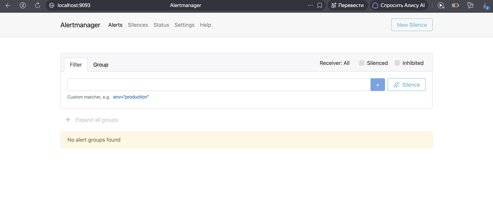
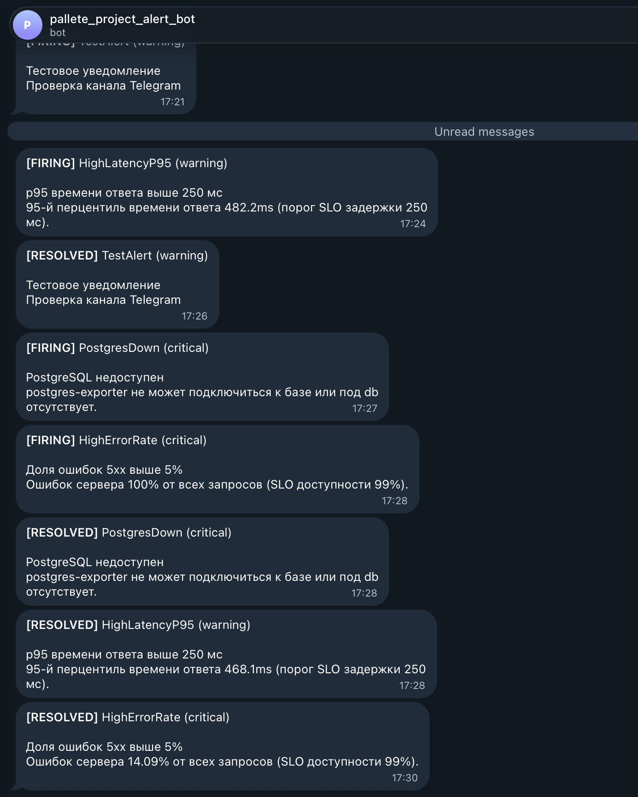
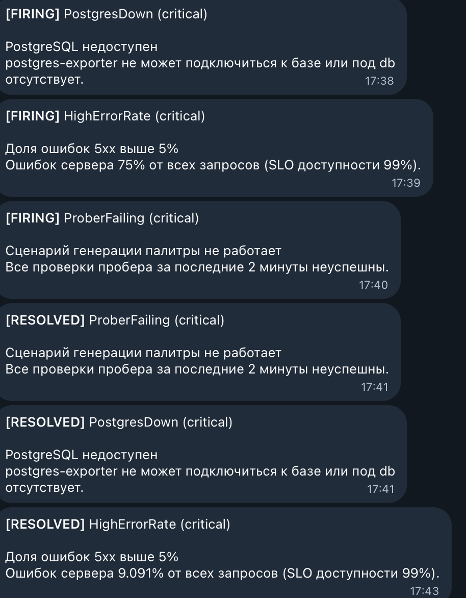

# Отчёт: алерты

## Схема

```
VictoriaMetrics ──(запросы раз в 15 с)── vmalert ──(сработавшие алерты)──> Alertmanager ──> Telegram
```

- **vmalert** вычисляет правила из [`alerts.yml`](../k8s/monitoring/alerting/alerts.yml) по данным VictoriaMetrics и отправляет сработавшие алерты в Alertmanager. Состояние алертов (`ALERTS`) записывается обратно в VictoriaMetrics.
- **Alertmanager** группирует алерты по имени и отправляет уведомления в Telegram: [`alertmanager.yml`](../k8s/monitoring/alerting/alertmanager.yml). Уведомление приходит при срабатывании (`[FIRING]`) и при восстановлении (`[RESOLVED]`).

Манифесты: [`k8s/monitoring/alerting/`](../k8s/monitoring/alerting), применяются командой `kubectl apply -k k8s/monitoring/alerting`. Токен бота и chat id хранятся в Secret и в репозиторий не попадают.

## Алерты на метрики сервиса

| Алерт | Условие | Уровень | Почему так |
|---|---|---|---|
| `BackendDown` | ни один под `backend` не отвечает (`up`) дольше 1 мин | critical | сервис полностью недоступен, остальные алерты бэкенда в этот момент не вычисляются |
| `HighErrorRate` | доля ответов 5xx за 2 мин > 5% дольше 1 мин | critical | при SLO доступности 99% такая доля ошибок быстро исчерпывает бюджет ошибок |
| `ProberFailing` | все проверки пробера за 2 мин неуспешны, дольше 1 мин | critical | не работает основной пользовательский сценарий (генерация палитры), даже если бэкенд отвечает |
| `PostgresDown` | `pg_up == 0` или метрика отсутствует дольше 1 мин | critical | без базы не работают сохранение палитр и вход; указывает на причину сбоя |
| `LoginFailuresSpike` | > 10 неудачных входов в минуту дольше 2 мин | warning | бизнес-метрика `auth_login_total`: признак подбора пароля или сломанной формы входа |

## Алерты на метрики рантайма и фреймворка

Метрики отдают `prometheus-fastapi-instrumentator` (HTTP) и `prometheus_client` (процесс Python).

| Алерт | Условие | Уровень | Почему так |
|---|---|---|---|
| `HighLatencyP95` | p95 времени ответа (`http_request_duration_highr_seconds`) > 250 мс дольше 1 мин | warning | порог совпадает с SLO задержки; деградация видна до того, как запросы начнут падать |
| `HighMemoryUsage` | `process_resident_memory_bytes` > 200 MiB дольше 5 мин | warning | лимит контейнера 256 MiB; при превышении Kubernetes завершит под (OOMKilled) |

`HighErrorRate` также основан на метрике фреймворка `http_requests_total`.

## Выбор порогов и длительностей

- **`for: 1m`** отсекает кратковременные всплески (например, перезапуск пода), но позволяет показать срабатывание в демонстрации. Для продакшена длительности стоит увеличить до 5–10 минут.
- **Уровни:** `critical` — пользователи уже затронуты; `warning` — деградация или риск сбоя.
- **Окна `rate` 2 минуты** — не меньше восьми точек при опросе раз в 15 секунд.

## Демонстрация

Сбои включаются через внедрение сбоев в бэкенде (`FAULT_DELAY_MS`, `FAULT_ERROR_RATE`) и остановку базы данных.

| Действие | Сработавшие алерты |
|---|---|
| `kubectl set env deployment/backend FAULT_DELAY_MS=400` | `HighLatencyP95` |
| `kubectl set env deployment/backend FAULT_DELAY_MS=0 FAULT_ERROR_RATE=0.3` | `HighErrorRate`, `ProberFailing` |
| `kubectl scale statefulset db --replicas=0` | `PostgresDown`, `ProberFailing`, `HighErrorRate` |
| возврат в норму | уведомления `[RESOLVED]` |

### Созданные алерты (vmalert)


### Алерты в Alertmanager



### Уведомления в Telegram



Последовательность уведомлений:
- `TestAlert` — тестовый алерт, отправленный напрямую в Alertmanager для проверки канала;
- `HighLatencyP95` (warning) — после включения задержки 400 мс p95 времени ответа вырос до 482 мс;
- `PostgresDown` и `HighErrorRate` (critical) — после остановки базы данных все запросы к палитрам завершались ошибкой 500;
- `[RESOLVED]` — после возврата в норму Alertmanager прислал уведомления о восстановлении.

Повторная остановка базы данных примерно на 3 минуты: кроме `PostgresDown` и `HighErrorRate`, сработал `ProberFailing` — все проверки пользовательского сценария за 2 минуты были неуспешны.



**Важно при чтении `[RESOLVED]`:** уведомление о восстановлении повторяет текст алерта в том виде, в каком он был при последнем вычислении во время сбоя. Значение в описании — последнее значение при срабатывании, текущее значение метрики в момент восстановления в нём не отображается. Например, `[RESOLVED] HighErrorRate` с текстом «Ошибок сервера 9.091%» означает, что перед восстановлением доля ошибок снизилась до 9,091%, а затем опустилась ниже порога 5%. Благодаря этому по уведомлению о восстановлении видно, как выглядела ошибка непосредственно перед её устранением.
