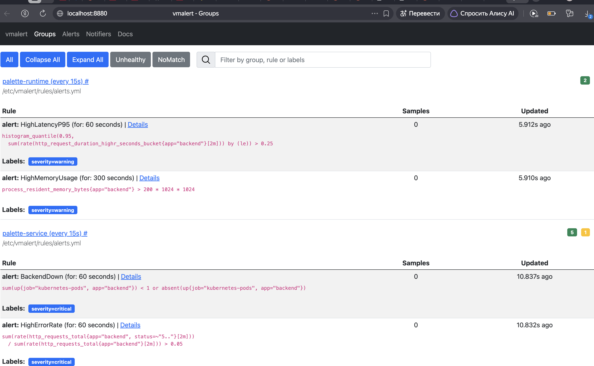
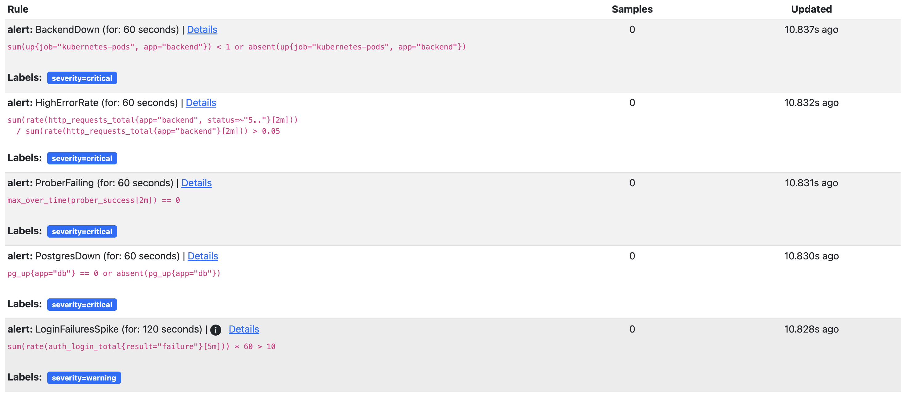
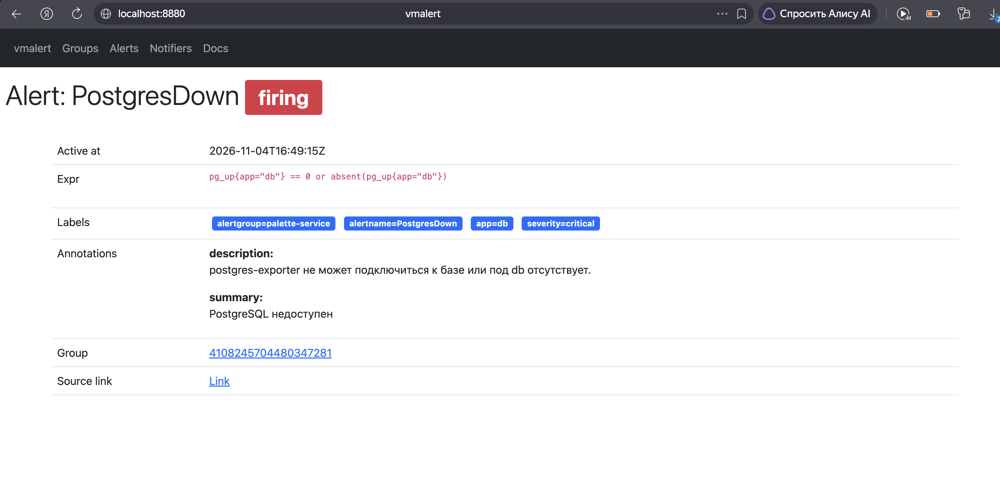
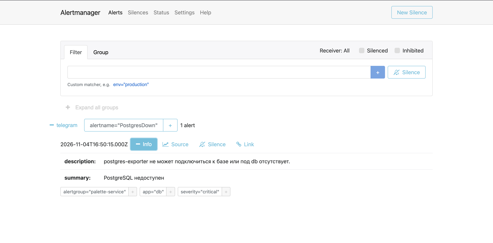
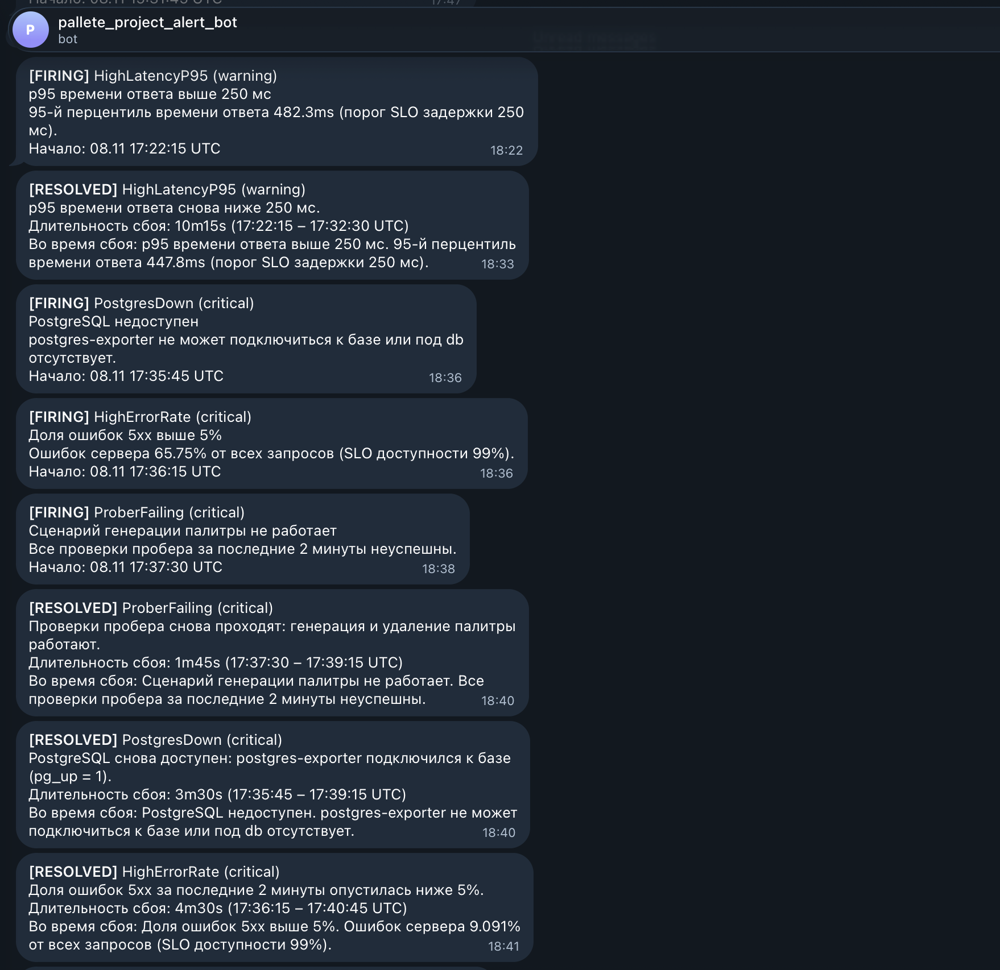
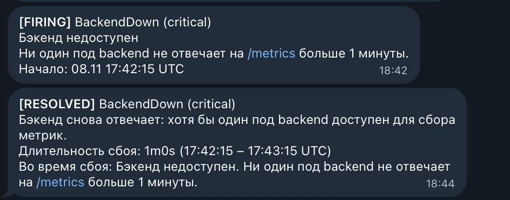

# Отчёт: алерты

## Схема

```
VictoriaMetrics ──(запросы раз в 15 с)── vmalert ──(сработавшие алерты)──> Alertmanager ──> Telegram
```

- **vmalert** вычисляет правила из [`alerts.yml`](../k8s/monitoring/alerting/alerts.yml) по данным VictoriaMetrics и отправляет сработавшие алерты в Alertmanager. Состояние алертов (`ALERTS`) записывается обратно в VictoriaMetrics.
- **Alertmanager** группирует алерты по имени и отправляет уведомления в Telegram: [`alertmanager.yml`](../k8s/monitoring/alerting/alertmanager.yml). Уведомление приходит при срабатывании (`[FIRING]`) и при восстановлении (`[RESOLVED]`).

Манифесты: [`k8s/monitoring/alerting/`](../k8s/monitoring/alerting), применяются командой `kubectl apply -k k8s/monitoring/alerting`. Токен бота и chat id хранятся в Secret и в репозиторий не попадают.

## Алерты на метрики сервиса

| Алерт | Условие | Уровень | Почему так |
|---|---|---|---|
| `BackendDown` | ни один под `backend` не отвечает (`up`) дольше 1 мин | critical | сервис полностью недоступен, остальные алерты бэкенда в этот момент не вычисляются |
| `HighErrorRate` | доля ответов 5xx за 2 мин > 5% дольше 1 мин | critical | при SLO доступности 99% такая доля ошибок быстро исчерпывает бюджет ошибок |
| `ProberFailing` | все проверки пробера за 2 мин неуспешны, дольше 1 мин | critical | не работает основной пользовательский сценарий (генерация палитры), даже если бэкенд отвечает |
| `PostgresDown` | `pg_up == 0` или метрика отсутствует дольше 1 мин | critical | без базы не работают сохранение палитр и вход; указывает на причину сбоя |
| `LoginFailuresSpike` | > 10 неудачных входов в минуту дольше 2 мин | warning | бизнес-метрика `auth_login_total`: признак подбора пароля или сломанной формы входа |

## Алерты на метрики рантайма и фреймворка

Метрики отдают `prometheus-fastapi-instrumentator` (HTTP) и `prometheus_client` (процесс Python).

| Алерт | Условие | Уровень | Почему так |
|---|---|---|---|
| `HighLatencyP95` | p95 времени ответа (`http_request_duration_highr_seconds`) > 250 мс дольше 1 мин | warning | порог совпадает с SLO задержки; деградация видна до того, как запросы начнут падать |
| `HighMemoryUsage` | `process_resident_memory_bytes` > 200 MiB дольше 5 мин | warning | лимит контейнера 256 MiB; при превышении Kubernetes завершит под (OOMKilled) |

`HighErrorRate` также основан на метрике фреймворка `http_requests_total`.

## Выбор порогов и длительностей

- **`for: 1m`** отсекает кратковременные всплески (например, перезапуск пода), но позволяет показать срабатывание в демонстрации. Для продакшена длительности стоит увеличить до 5–10 минут.
- **Уровни:** `critical` — пользователи уже затронуты; `warning` — деградация или риск сбоя.
- **Окна `rate` 2 минуты** — не меньше восьми точек при опросе раз в 15 секунд.

## Демонстрация

Сбои вызывались по одному: следующий начинался только после того, как предыдущий завершился уведомлением `[RESOLVED]`. Сбои включаются через внедрение сбоев в бэкенде (`FAULT_DELAY_MS`) и остановку компонентов.

| Шаг | Действие | Сработавшие алерты | Длительность сбоя (из уведомлений) |
|---|---|---|---|
| 1 | `kubectl set env deployment/backend FAULT_DELAY_MS=400`, затем `FAULT_DELAY_MS=0` | `HighLatencyP95` | 10m15s |
| 2 | `kubectl scale statefulset db --replicas=0`, затем `--replicas=1` | `PostgresDown`, `HighErrorRate`, `ProberFailing` | 3m30s, 4m30s, 1m45s |
| 3 | `kubectl scale deployment backend --replicas=0`, затем `--replicas=2` | `BackendDown` | 1m0s |

### Созданные алерты (vmalert)

Обе группы правил загружены из `alerts.yml` и вычисляются каждые 15 секунд: `palette-runtime` (2 правила) и `palette-service` (5 правил). Скриншоты сделаны после восстановления, поэтому активных алертов нет.





Жёлтая метка «1» у группы `palette-service` относится к `LoginFailuresSpike`: в окне 5 минут не было неудачных входов, поэтому запрос не вернул ни одного ряда (состояние NoMatch). Это нормальное состояние правила: алерт сработает при появлении неудачных входов выше порога.

Сработавший алерт `PostgresDown` в vmalert во время остановки базы данных: состояние `firing`, выражение, метки и аннотации.



### Alertmanager

Во время сбоя Alertmanager получил `PostgresDown` от vmalert и направил его получателю `telegram`; группировка — по имени алерта (`alertname`).



После восстановления активных групп алертов нет, все алерты закрыты (уведомления `[RESOLVED]` выше).


### Уведомления в Telegram

Уведомления формируются шаблоном в [`alertmanager.yml`](../k8s/monitoring/alerting/alertmanager.yml); по одному сообщению на каждый алерт, отдельно при срабатывании и при восстановлении.

**Структура `[FIRING]`** — что случилось и когда началось:

| Строка | Откуда берётся | Пример |
|---|---|---|
| статус, имя алерта, уровень | метки `alertname`, `severity` | `[FIRING] PostgresDown (critical)` |
| кратко, что случилось | аннотация `summary` | `PostgreSQL недоступен` |
| подробности с текущим значением | аннотация `description` | `Ошибок сервера 65.75% от всех запросов` |
| время начала | `StartsAt` | `Начало: 08.11 17:35:45 UTC` |

**Структура `[RESOLVED]`** — что восстановилось, сколько длился сбой и как он выглядел:

| Строка | Откуда берётся | Пример |
|---|---|---|
| статус, имя алерта, уровень | метки `alertname`, `severity` | `[RESOLVED] PostgresDown (critical)` |
| что восстановилось | аннотация `resolved` у правила в [`alerts.yml`](../k8s/monitoring/alerting/alerts.yml) | `PostgreSQL снова доступен: postgres-exporter подключился к базе (pg_up = 1).` |
| длительность сбоя, начало и конец | `EndsAt − StartsAt` | `Длительность сбоя: 3m30s (17:35:45 – 17:39:15 UTC)` |
| как выглядел сбой | `summary` и `description` | `Во время сбоя: Доля ошибок 5xx выше 5%. Ошибок сервера 9.091% …` |

Почему так: в первой версии `[RESOLVED]` повторял текст срабатывания, и по паре сообщений с одинаковым текстом было непонятно, что произошло и чем закончилось. Теперь у каждого правила есть отдельный текст восстановления, а длительность сбоя видна сразу.

Значение в строке «Во время сбоя» — последнее, которое vmalert зафиксировал перед восстановлением: аннотации в `[RESOLVED]` передаются в том виде, в каком были при последнем вычислении во время сбоя. Например, у `HighErrorRate` при срабатывании было 65.75% ошибок, а перед восстановлением доля снизилась до 9.091%, после чего опустилась ниже порога 5%.

**Шаги 1 и 2: задержка и отказ базы данных.** `HighLatencyP95` сработал при p95 482.3 мс. При остановке базы первым сработал `PostgresDown`, через 30 секунд `HighErrorRate`, ещё через минуту `ProberFailing`. Первым восстановился `ProberFailing` — проверки пробера проходят сразу после запуска базы; последним — `HighErrorRate`, потому что доля ошибок считается за окно 2 минуты.



**Шаг 3: остановка бэкенда.** `BackendDown` сработал, когда ни один под `backend` не отвечал на `/metrics` дольше минуты, и восстановился после возврата двух реплик.


