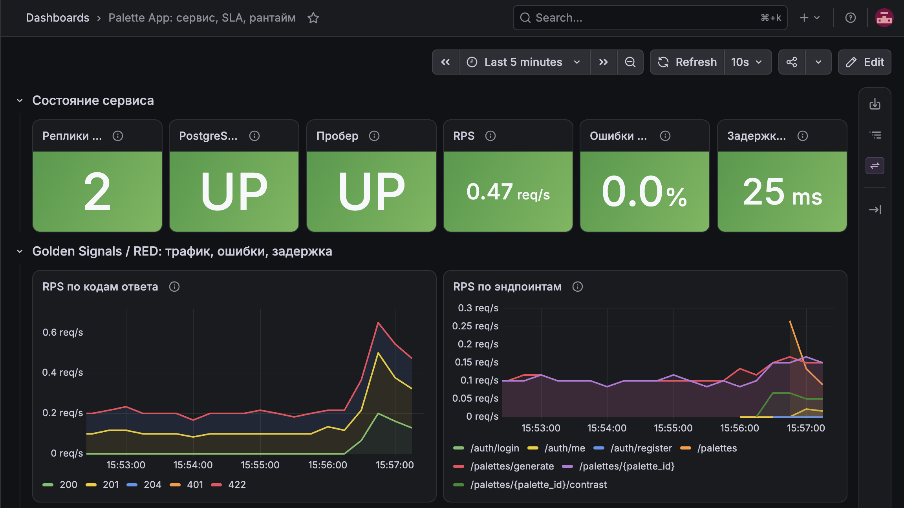
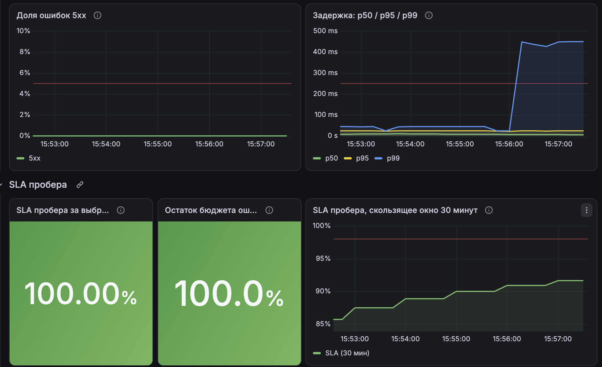
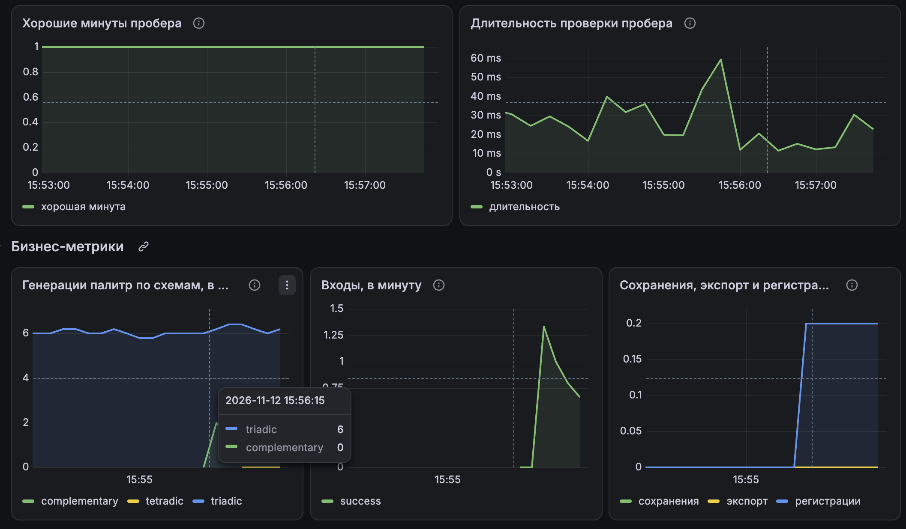
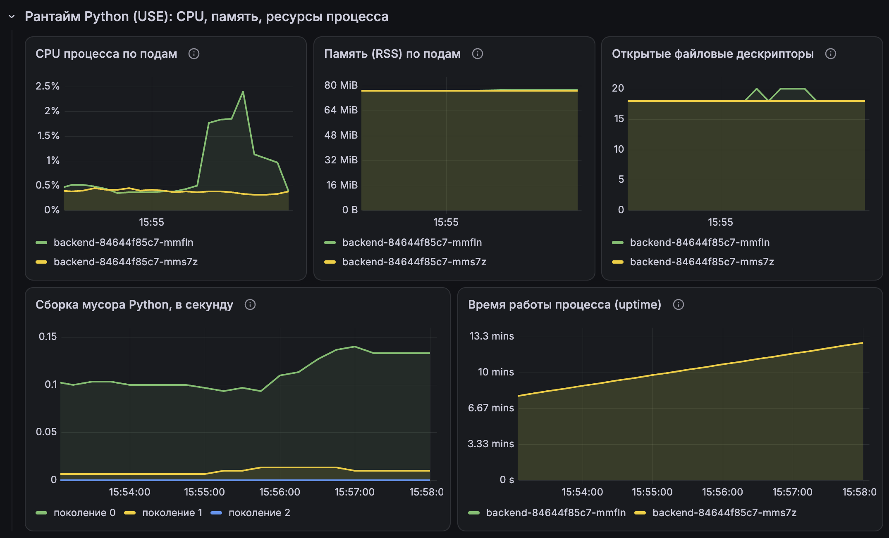
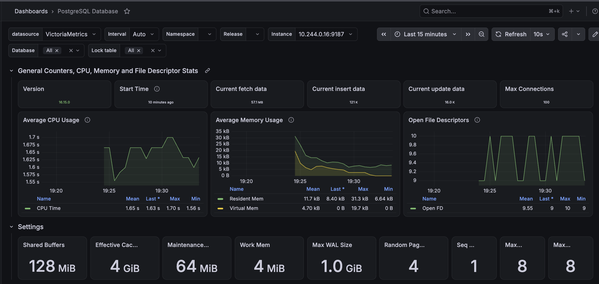
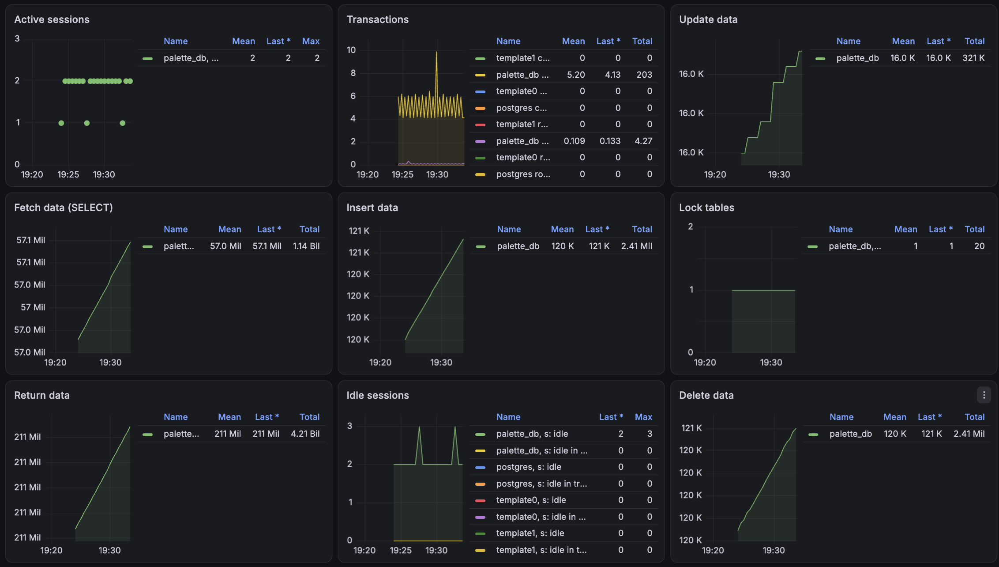
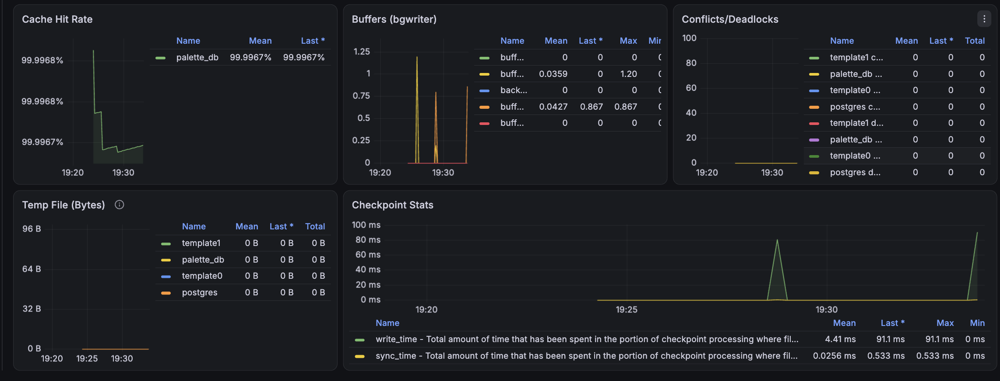

# Отчёт: дашборды Grafana

## Развёртывание и источники данных

Grafana установлена в namespace `monitoring` Helm-чартом `grafana-community/grafana` со значениями [`k8s/monitoring/grafana/values.yaml`](../k8s/monitoring/grafana/values.yaml).

- **Источник данных** один — **VictoriaMetrics** (`http://vmsingle-victoria-metrics-single-server.monitoring.svc:8428`). Он добавлен как тип Prometheus: VictoriaMetrics поддерживает Prometheus API и язык запросов. Источник создаётся автоматически при установке (provisioning) с фиксированным `uid: victoriametrics`, на который ссылается дашборд.
- **Дашборд приложения** хранится в репозитории как JSON: [`k8s/monitoring/grafana/palette-dashboard.json`](../k8s/monitoring/grafana/palette-dashboard.json). Он загружается в Grafana через ConfigMap с меткой `grafana_dashboard=1`, которую отслеживает sidecar чарта ([`kustomization.yaml`](../k8s/monitoring/grafana/kustomization.yaml)).
- **Дашборд PostgreSQL** импортирован из каталога Grafana (ID 9628, «PostgreSQL Database») и работает на метриках postgres-exporter из того же источника.

## Дашборд приложения

Дашборд «Palette App: сервис, SLA, рантайм» построен сверху вниз: сначала общее состояние, затем сигналы RED / Golden Signals, SLA, бизнес-метрики и детализация рантайма (USE). Окно по умолчанию — 30 минут, обновление раз в 10 секунд.

### Состояние сервиса

Строка из шести показателей отвечает на вопрос «всё ли в порядке» без чтения графиков.

| Панель | Метрика | Почему |
|---|---|---|
| Реплики backend UP | `sum(up{app="backend"})` | сколько реплик бэкенда доступны; ожидается 2 |
| PostgreSQL | `pg_up` | доступность базы, без неё не работает основной сценарий |
| Пробер | `prober_success` | работает ли пользовательский сценарий целиком |
| RPS | `rate(http_requests_total)` | трафик (Rate / Traffic) |
| Ошибки 5xx | доля `status=~"5.."` | ошибки (Errors); пороги 1% и 5% как у SLO и алерта |
| Задержка p95 | `histogram_quantile(0.95, …)` | задержка (Duration / Latency); порог 250 мс как у SLO |

### Golden Signals / RED

| Панель | Метрика | Почему |
|---|---|---|
| RPS по кодам ответа | `http_requests_total` по `status` | трафик и одновременно видно, какая часть ответов 4xx и 5xx |
| RPS по эндпоинтам | `http_requests_total` по `handler` | какие ручки API нагружены |
| Доля ошибок 5xx | доля 5xx за 2 мин, линия 5% | динамика ошибок относительно порога алерта |
| Задержка p50 / p95 / p99 | гистограмма `http_request_duration_highr_seconds` | p50 — типичный запрос, p95 и p99 — медленные; линия 250 мс — SLO |

Подход RED (Rate, Errors, Duration) выбран для бэкенда, потому что это сервис, обрабатывающий запросы: для пользователя важны именно число запросов, ошибки и время ответа. Вместе с насыщением (раздел рантайма) это четыре Golden Signals.

На скриншоте ниже: доля ошибок 5xx и задержка, затем начало раздела SLA. Ошибок 5xx нет. p50 и p95 держатся ниже порога 250 мс. p99 вырос, когда к трафику пробера добавились ручные запросы через интерфейс (вход, регистрация, сохранение).

### SLA пробера

SLA считается по проберу как доля хороших минут: минута хорошая, если все проверки пробера в ней успешны. Цель SLA — 98%.

| Панель | Запрос | Что показывает |
|---|---|---|
| SLA пробера за выбранный период | `avg_over_time(min_over_time(prober_success[1m])[$__range:1m])` | SLA за период, выбранный в Grafana (по умолчанию 30 минут); зелёный — не ниже 98% |
| Остаток бюджета ошибок | `1 - (1 - SLA) / (1 - 0.98)` | какая доля допустимых 2% плохих минут ещё не израсходована |
| SLA пробера, скользящее окно 30 минут | `avg_over_time(min_over_time(prober_success[1m])[30m:1m])` | как SLA меняется во времени; линия 98% |
| Хорошие минуты пробера | `min(min_over_time(prober_success[1m]))` | какие именно минуты были плохими |
| Длительность проверки пробера | `prober_duration_seconds` | время сценария generate + delete |

`$__range` — длительность периода, выбранного в Grafana, поэтому SLA за сутки или неделю получается сменой периода без изменения запроса.

На скриншоте выше SLA за последние 5 минут — 100%, бюджет ошибок не израсходован. Скользящее окно за 30 минут ниже 98%: в него попадает минута после перезапуска кластера, когда бэкенд ещё не был готов и проверка пробера не прошла. По мере сдвига окна значение растёт.

### Бизнес-метрики

| Панель | Метрика |
|---|---|
| Генерации палитр по схемам, в минуту | `palette_generated_total` по `scheme` (включает трафик пробера) |
| Входы, в минуту | `auth_login_total` по `result` |
| Сохранения, экспорт и регистрации, в минуту | `palette_saved_total`, `palette_exported_total`, `user_registered_total` |

Бизнес-метрики показывают, пользуются ли сервисом: технически здоровый сервис без генераций или с ростом неудачных входов — тоже повод разобраться.

### Рантайм Python (USE)

Детализация для разбора причин: метрики процесса от `prometheus_client`, по каждому поду.

| Панель | Метрика | USE |
|---|---|---|
| CPU процесса | `rate(process_cpu_seconds_total)` | Utilization |
| Память (RSS) | `process_resident_memory_bytes`, линия 200 MiB | Saturation: лимит контейнера 256 MiB, порог алерта `HighMemoryUsage` |
| Открытые файловые дескрипторы | `process_open_fds` | Saturation: утечка соединений |
| Сборка мусора | `rate(python_gc_collections_total)` по поколениям | нагрузка на память интерпретатора |
| Время работы процесса | `time() - process_start_time_seconds` | Errors: сброс до нуля — перезапуск пода |

## Дашборд PostgreSQL Exporter

Импортирован в Grafana: Dashboards → New → Import → ID `9628` → источник данных `VictoriaMetrics`. Дашборд показывает состояние базы по метрикам postgres-exporter (сайдкар в поде `db-0`): активные соединения, транзакции, операции со строками, размер базы, блокировки.

Что видно на дашборде:

- **Общие показатели:** версия PostgreSQL 16, лимит соединений 100, потребление CPU, памяти и файловых дескрипторов процессом экспортера.
- **Настройки** базы: `shared_buffers`, `work_mem`, `max_wal_size` и другие.
- **Сессии:** 2–3 соединения от бэкенда, большинство в состоянии idle. Запас до лимита большой.
- **Операции со строками:** число вставок и удалений почти совпадает, потому что пробер при каждой проверке создаёт палитру и удаляет её.
- **Cache Hit Rate** около 99,99%: данные читаются из памяти, а не с диска.
- **Конфликты, deadlock'и и временные файлы** — нули, проблем с блокировками и нехваткой `work_mem` нет.

Скриншоты сделаны за последние 15 минут, вскоре после перезапуска пода `db-0`.

Панель Start Time использует метрику `pg_postmaster_start_time_seconds`. В postgres-exporter её отдаёт коллектор `postmaster`, который по умолчанию выключен, поэтому он включён флагом `--collector.postmaster` в [`k8s/10-db.yaml`](../k8s/10-db.yaml).

Особенности дашборда 9628:

- **Фильтр Instance** — это адрес пода экспортера (`IP:9187`). После перезапуска `db-0` IP меняется, и в фильтре нужно выбрать новый адрес.
- **Шаг запроса.** Часть показателей (Start Time, Current fetch / insert / update data) запрашивается с крупным шагом: `maxDataPoints: 100` и `intervalFactor: 2`. За 6 часов это одна точка примерно раз в 7 минут. Сразу после перезапуска пода точек на такой сетке ещё нет, и эти показатели показывают N/A. На коротком периоде, например 15 минут, значения видны сразу.

## Файлы

| Файл | Что это |
|---|---|
| [`k8s/monitoring/grafana/values.yaml`](../k8s/monitoring/grafana/values.yaml) | значения Helm-чарта: источник данных VictoriaMetrics, sidecar дашбордов |
| [`k8s/monitoring/grafana/palette-dashboard.json`](../k8s/monitoring/grafana/palette-dashboard.json) | экспортированный JSON дашборда приложения |
| [`k8s/monitoring/grafana/kustomization.yaml`](../k8s/monitoring/grafana/kustomization.yaml) | ConfigMap с дашбордом для sidecar |
