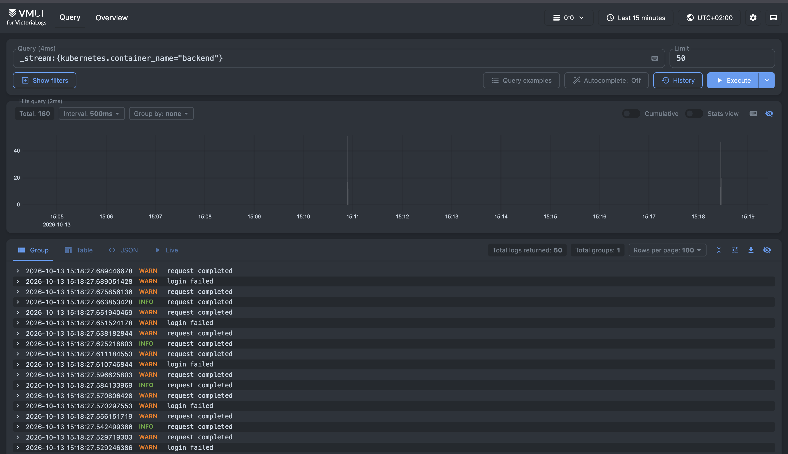
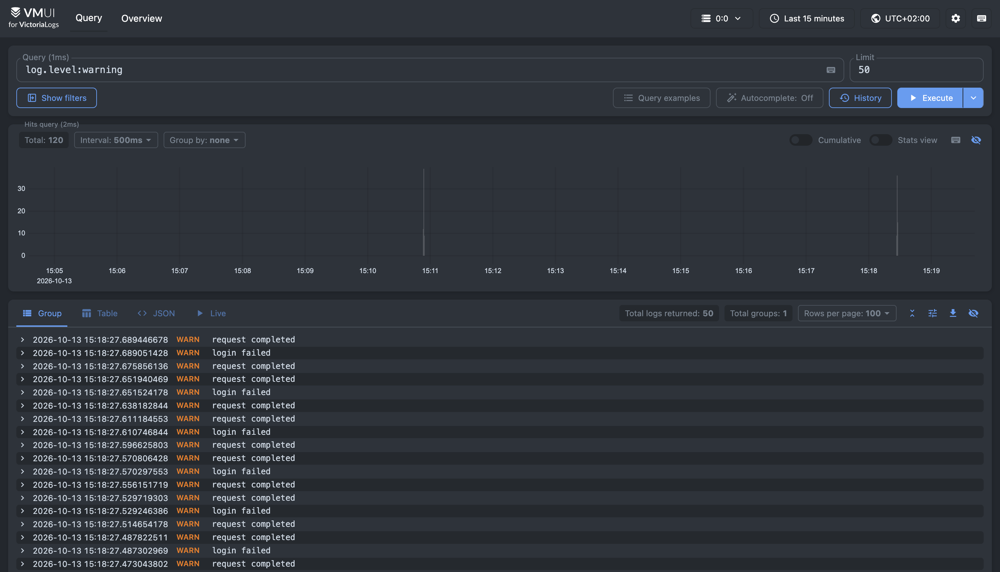
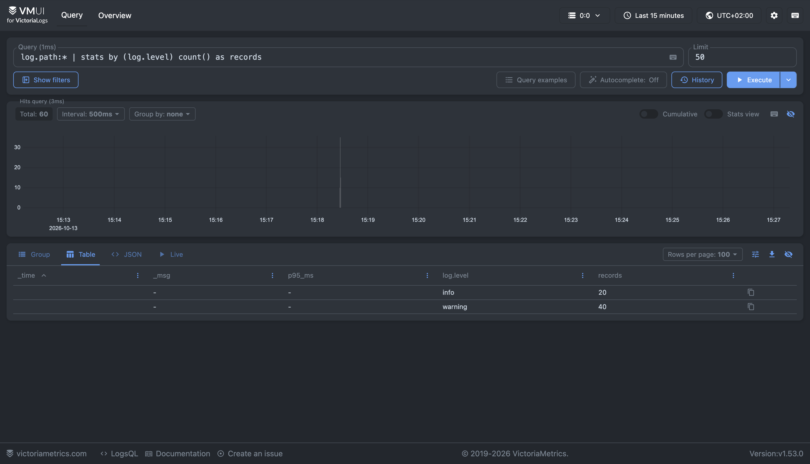
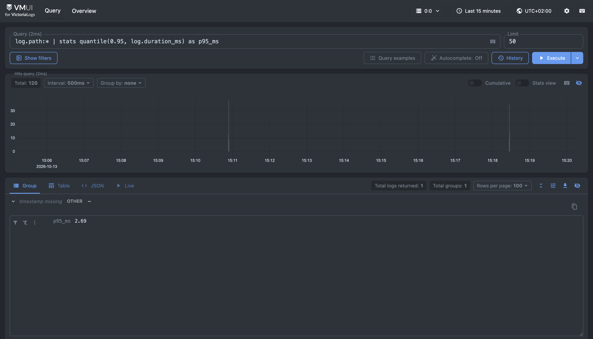

# Отчёт: логирование в Victoria Logs

## Развёртывание

Victoria Logs (single-node) развёрнута в том же minikube-кластере, что и приложение, официальным Helm-чартом `victoria-logs-single`. Значения чарта — [`k8s/logging/values.yaml`](../k8s/logging/values.yaml): постоянный том 2 Gi, хранение 7 дней, включённый Vector.

```sh
helm repo add vm https://victoriametrics.github.io/helm-charts/
helm install vl vm/victoria-logs-single -f k8s/logging/values.yaml
kubectl port-forward svc/<сервис Victoria Logs> 9428:9428   # vmui: http://localhost:9428/select/vmui/
```

## Формат логов

Бэкенд пишет одну JSON-запись на событие в stdout контейнера:
- форматтер — [`backend/app/logging_config.py`](../backend/app/logging_config.py);
- запись на каждый HTTP-запрос — middleware в [`backend/app/main.py`](../backend/app/main.py);
- события входа и регистрации — [`backend/app/routers/auth.py`](../backend/app/routers/auth.py).

Пример записи (`kubectl logs -l app=backend`):

```json
{"timestamp": "2026-10-13T13:18:27.689332+00:00", "level": "warning", "message": "request completed", "service.name": "palette-backend", "logger": "app", "request_id": "a73d55e89d85477ba75c937fc255d2f4", "method": "POST", "path": "/auth/login", "status": 401, "duration_ms": 2.04, "user_id": null}
```

| Поле | Значение |
|---|---|
| `timestamp` | время события, UTC, ISO 8601 |
| `level` | `info` (2xx/3xx), `warning` (4xx, неудачный вход), `error` (5xx, исключения) |
| `message` | текст события |
| `service.name` | `palette-backend` |
| `logger` | источник: `app`, `app.auth`, `uvicorn.error` |
| `request_id` | идентификатор запроса, также возвращается в заголовке `X-Request-ID` |
| `method`, `path`, `status`, `duration_ms` | параметры HTTP-запроса |
| `user_id` | id пользователя из JWT, `null` для гостя |
| `event` | `register`, `login`, `login_failed` |

Запросы к `/health` не логируются: их каждые 5 секунд выполняют пробы Kubernetes. Стандартный access-лог uvicorn отключён (`--no-access-log`), его заменяет middleware. Пароли и email в логи не пишутся.

## Доставка логов

Vector из Helm-чарта, запущенный как DaemonSet: один под на узел читает логи контейнеров из `/var/log/pods`, добавляет метаданные Kubernetes, разбирает JSON и отправляет записи в Victoria Logs. Поля приложения сохраняются с префиксом `log.` (`log.level`, `log.path`), `message` становится `_msg`.

Причина выбора: приложение пишет только в stdout и не зависит от системы логов; логи новых подов, в том числе после `kubectl scale`, собираются без изменения манифестов.

## Запросы LogsQL

Интервал во всех запросах — последние 15 минут. Тестовый трафик: запросы к `/openapi.json` (200), к несуществующему пути (404), вход с неверным паролем (401).

### (а) Записи бэкенда

```
_stream:{kubernetes.container_name="backend"}
```



Все записи контейнера `backend` за интервал, 160 записей. Уровни INFO и WARN распознаны, значит JSON разобран на поля.

### (б) Фильтр по уровню

```
log.level:warning
```



Записи уровня `warning`, 120 записей: ответы 404 и 401 и события `login failed`.

### (в) Количество запросов по уровням

```
log.path:* | stats by (log.level) count() as records
```



HTTP-запросы, сгруппированные по уровню: 20 `info` и 40 `warning`. Фильтр `log.path:*` оставляет только записи о запросах.

### (г) 95-й перцентиль времени ответа

```
log.path:* | stats quantile(0.95, log.duration_ms) as p95_ms
```



95% запросов обработаны быстрее 2.91 мс.
